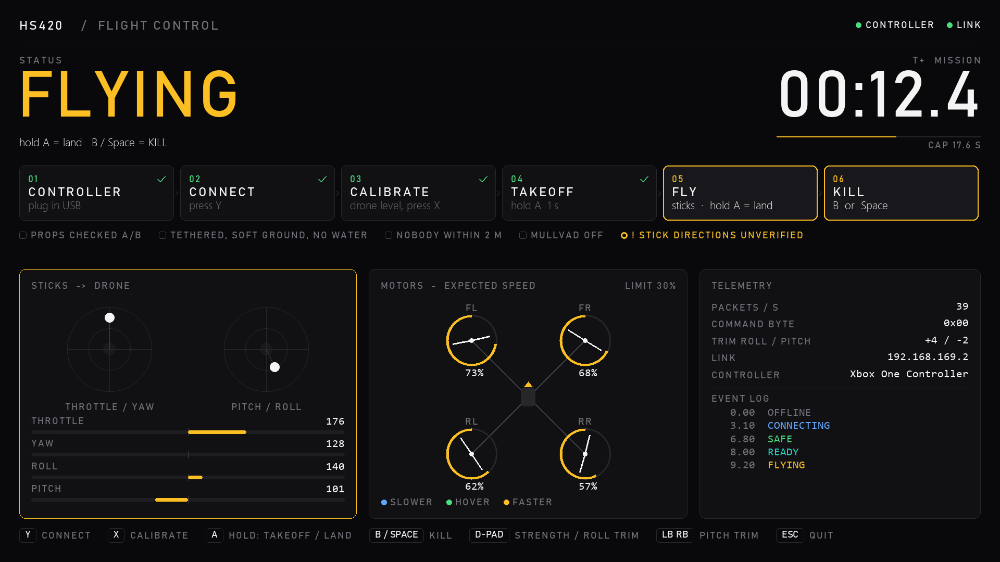

# Drone software

Software to fly a Holy Stone HS420 autonomously: from one sentence of text, the drone lifts off table A and lands on table B. Separate from the Arixfly website at the repo root.

Plan, rules and current status: [CLAUDE.md](CLAUDE.md). Full test log with every byte we found: [notes/findings.md](notes/findings.md).

## What works so far

- The drone is controlled over Wi-Fi. It opens its own network (`HolyStoneFPV_…`), and the app sends UDP packets to `192.168.169.1:8800` about 39 times per second.
- Packet layout (`ef 02` type, 88 bytes), decoded from the HS420 app itself (class `lxMjxCtrlPro`): bytes 20–23 = throttle, yaw, roll, pitch (0–255, centre 128; roll and pitch carry the app's trim), byte 24 = speed level, byte 25 = commands (`0x01` takeoff, `0x02` land, `0x04` emergency stop, `0x20` flip, `0x80` gyro calibration), XOR checksum of bytes 19–26 at 27.
- One-key takeoff from the laptop works (lifted off 2 of 2).
- Failsafe: the motors stop about 1.2 s after the last packet.

**2026-11-05: the drone crashed into water.** The flight window had used a stick order and command bits taken from a different app (turbodrone), so throttle went to the roll byte and the drone was never calibrated. The code now follows the decoded app layout. Not verified yet: stick directions, gyro calibration `0x80`, emergency stop `0x04` in flight, land `0x02`. No free flights until those are checked; see [notes/findings.md](notes/findings.md).



## Tools

All scripts run from this folder and print a usage note at the top.

| Script | What it does |
|---|---|
| `tools/wifi_scan.py` | Forces a Windows Wi-Fi scan and diffs it against a baseline, to find the drone's network |
| `tools/pcap_filter.py` | Keeps only packets to or from given IPs (drops other apps' traffic unread) |
| `tools/pcap_summary.py` | Flow table and sample payloads of a capture |
| `tools/replay_test.py` | Sends control packets from the laptop. Dry run by default; `--send` joins the drone Wi-Fi, `--listen` times the motors with the mic |
| `tools/joystick_fly.py` | Flight window for the Xbox controller: Y connect, X calibrate, hold A takeoff / land, B or Space emergency stop, D-pad strength and roll trim, LB/RB pitch trim, time cap with auto landing |
| `tools/preflight_test.py` | Scripted props-off / tethered runs (calibrate, takeoff, e-stop, land, throttle steps), timed with the mic |
| `tools/flight_ui.py` | Mission-control style drawing for the flight window (`python tools/flight_ui.py` renders previews) |
| `tools/controller_test.py` | Test screen for the controller: sticks, drift, buttons, triggers, rumble |
| `tools/motor_listen.py` | Laptop mic: when the motors run and at what pitch. Saves numbers only, no audio unless `--keep-wav` |
| `tools/aruco_tags.py` | Makes the printable A4 tag sheet in `markers/` |
| `tools/aruco_track.py` | Webcam tracker: distance and heading from the drone tag to the table-B tag |

Requirements: Python 3.12, `pygame-ce`, `opencv-python` (with the `aruco` module), `numpy`, `Pillow`, `sounddevice`.

```bash
cd drone-software
python tools/replay_test.py              # dry run, sends nothing
python tools/controller_test.py          # check the controller, no drone
python tools/joystick_fly.py --dry       # flight window without sending
python tools/aruco_track.py              # live webcam tracker, q to quit
```

## Safety

Every new command is tested with the propellers off or the drone tethered. Every flight script has a hard time cap and a kill path. Never fly near people.

## Folders

- `tools/`: Python scripts
- `captures/`: packet captures, filtered to the drone's IPs only
- `notes/findings.md`: test log
- `markers/`: ArUco tag sheet (PNG and PDF, print at 100 %)
- `docs/`: screenshots
