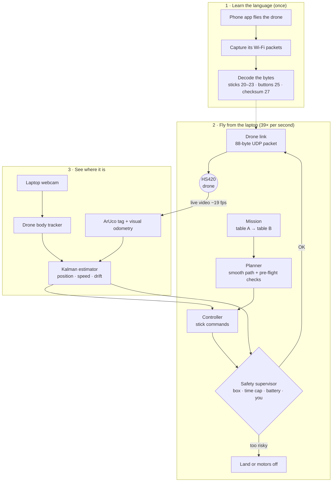

# Arixfly Drone v2

**Teaching a toy drone to fly itself, using only a laptop and the drone's own app as a guide.**

## What this is

The drone here is a Holy Stone HS420: a cheap consumer quadcopter you can buy off the shelf and fly from a phone app. It was never meant to be programmed. There's no SDK and no developer mode, and nobody ships documentation for its radio link.

But the phone app has to talk to the drone somehow. So we watched that conversation. The HS420 opens its own Wi-Fi network, and the app sends it a small 88-byte message about 39 times per second over UDP. Inside that message, four bytes are the sticks (throttle, yaw, roll, pitch) and one byte holds the buttons (takeoff, land, emergency stop). Once you know which byte is which, a laptop can say exactly the same things the phone says.

That's the whole trick, and it's not a hack. We didn't break any encryption, flash any firmware or bypass any lock. The laptop speaks the drone's own language, read from our own app and our own captures. Then we put a brain on top of it.

### How it fits together



## What it can do

Picture a drone that has no GPS, no position sensor and no idea where it is. It also turns right by itself at about 7° per second and drifts backwards with the sticks centred. Its video reaches the laptop up to 0.3 seconds late. Now try to land it on a table.

That's the problem this repo works on.

- **The laptop flies the drone.** Takeoff, landing, emergency stop and every stick axis come from Python. You can fly from the keyboard or an Xbox controller, or let the autopilot do it.
- **It sees through the drone's own eyes.** Every frame of the onboard camera streams live to the laptop at about 19 fps while the drone is flying. Getting there meant finding out that the drone sends 4 frames and then waits for an "I got it" for each one, so a single missed acknowledgement freezes the feed.
- **It flies toward a target.** A printed ArUco tag (a QR-code-like marker) sits on the landing table. From one camera picture the drone works out the distance and the direction to the tag, steers toward it and lands in front of it. At 1 m the distance reading was within 4 % of the true value.
- **It knows which way it's facing.** Visual odometry compares each camera frame to the one before. On recorded flights its heading error was 0.02° (median), and that holds the nose straight even when the tag is out of view.
- **It learns its own bad habits.** The v2 flight stack (`flight/`) runs a Kalman filter that estimates where the drone is, how fast it moves and how much it drifts. It learns that drift during each flight and cancels it. Video arrives late, so the filter rewinds to the moment each frame was taken and replays everything since then.
- **Safety has the last word.** A separate supervisor checks every command against a flight box, a time cap, battery level, lost video and how close the drone is to you. Depending on the check it lands the drone or cuts the motors. On the drone, Space is always the kill switch.
- **There's a simulator that doubts itself.** Each simulated flight draws its own slightly wrong drone (other gains, lags, drift and camera tilt), so the software is tested against a model that's wrong. If it only works on a perfect drone, it doesn't count.

Every number above was measured on the real drone and is logged in [notes/findings.md](notes/findings.md), including the day it crashed into water because we trusted a byte layout from a different drone's app.

This is research in progress, not a finished product. Real flights so far are tethered or close to the ground. Full A-to-B autonomy works in the simulator and is still being tuned on the real drone.


## Fly your own drone with it

You don't need to understand every line here. The repo is written so that an AI coding assistant, such as [Claude Code](https://claude.com/claude-code), can read it, understand the method and redo it for your drone. That can be the same HS420 or a completely different one. Treat this code as a worked example, not a library.

### Steps

1. **Fork this repo** and clone it to your laptop.
2. **Check that your drone talks over Wi-Fi.** Turn it on and look for a new Wi-Fi network (often named `…FPV…` or after the brand). If your drone uses only its own radio remote and no app, this method won't work as-is.
3. **Open the folder in Claude Code** (or your AI assistant of choice) and paste the prompt below.
4. **Capture your app.** The assistant will ask you to record the app's traffic while you do one move at a time: takeoff, land, each stick. This is the most important step, because the assistant must learn your drone from your drone and not guess.
5. **Test with the propellers off first.** Then fly tethered on a string over soft ground. Change one thing per test and write down what happened.
6. **Close the loop.** Print the ArUco tag sheet from [markers/](markers/), then work up step by step: live video, tag distance, autopilot, simulator.

### The prompt

```text
Take a look at how this repo works: README.md, CLAUDE.md (plan, rules, status log),
notes/findings.md (every verified byte and test), tools/ and flight/.

I want to do the same thing with MY drone: <brand and model>, controlled by the app
<app name>. Use this repo as inspiration and as a method, not as truth. My drone's
protocol is probably different.

Work the same way this project did:
1. Help me find out how my app talks to my drone (Wi-Fi network, IP, port, packet rate).
2. Ask me for captures of one move at a time, and decode the packets only from MY captures.
   Never assume a byte layout from another drone or app.
3. Build a laptop sender with a dry-run mode, a hard time cap and a kill key.
4. Plan props-off and tethered tests, one change per test, and log the results in
   notes/findings.md.
5. Only then: live video, tag tracking, the autopilot, and a simulator.

Rules: only my own drone and my own captures. Never break encryption or bypass
access protection. If pairing or encryption blocks us, stop and tell me.
Safety first, and never fly near people.
```

If you have the exact same drone (HS420), skip the decoding and start with `tools/live_flight_v2.py --test 10` (props off), then read [notes/next_steps.md](notes/next_steps.md).

## Try it without a drone

Python 3.12 with `numpy`, `opencv-contrib-python` (for ArUco), `pygame-ce`, `Pillow` and `sounddevice`.

```bash
python flight/sim.py --runs 20            # simulated A-to-B flights with a scorecard
python flight/planner.py missions/a_to_b.json   # plan a route and run the pre-flight checks
python tests/run_all.py                   # loopback tests, never touch the drone
python tools/joystick_fly.py --dry        # the flight window, sending nothing
```

## Map of the repo

| Folder | What's inside |
|---|---|
| `flight/` | The v2 stack: world geometry, motion model, Kalman estimator, planner, controller, safety supervisor, pilot states, simulator |
| `tools/` | Everything live: the drone link and video (`drone_link.py`), flight windows (`live_flight_v2.py`, `joystick_fly.py`), tag tracking, visual odometry (`tracker.py`), flight review, packet capture helpers |
| `tests/` | Fake drones and simulators that the code is tested against, never the real drone |
| `calib/` | Camera calibration, motion model and trims measured on our drone |
| `missions/`, `shows/` | Routes and timed move scripts as JSON |
| `notes/` | The lab notebook: findings, drift and battery measurements, next steps |
| `technicalFeasability/` | Six product ideas built on this, each with a feasibility check |
| `markers/` | Printable ArUco tag sheet (print at 100 %) |

## Safety and the law

Test every new command with the propellers off or the drone tethered. Every flight script has a hard time cap and a kill key. Never fly near people, animals or water. Only work with a drone you own, and check your country's drone rules before you fly (in the EU that means the A1/A3 open category).
