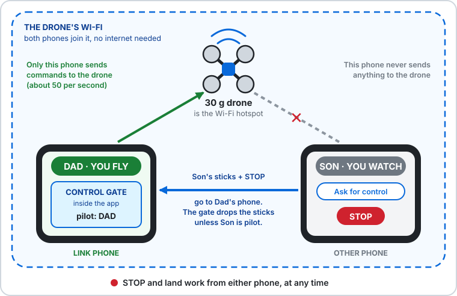
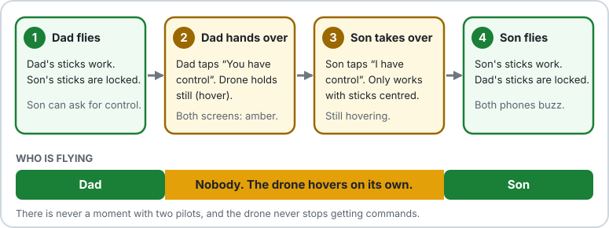

# Can a Dad and a son fly one tiny drone together? YES.

**Drone A** = a 30 g drone that makes its own Wi-Fi and is flown from a phone app (many toy drones work this way, and so does our own HS420)

**Job B** = Dad and son share one drone, swap pilot and co-pilot, and never fly at the same time by mistake

## The big idea
The drone is not the problem. Toy drones this light already make their own Wi-Fi and already take commands from a phone.
The new part is **a rule inside the app**: only one person flies at a time, and both phones always show who.

1. **Both phones join the drone's Wi-Fi.** The phones talk to each other over that same Wi-Fi.
2. One app, two roles: **pilot** and **co-pilot**.
3. Only the pilot's sticks reach the drone. The co-pilot's sticks are locked.
4. **STOP and land** work from both phones, always.
5. Swapping takes a short "I have control / You have control" handshake. The drone hovers in between.

## Sketch

## How it works

### The parts
| Part | In plain words |
|---|---|
| **Drone** | 30 g, and it is the Wi-Fi hotspot. It obeys small command packets from any phone on its Wi-Fi (on our HS420: UDP, about 39 per second). It knows nothing about Dad or son. |
| **Both phones** | Both join the drone's Wi-Fi. No home Wi-Fi and no internet are needed while flying. |
| **Link phone** | The phone that starts the flight (say Dad's). It is **the only phone that sends commands to the drone**. Swapping pilot and co-pilot does not change this. |
| **Other phone** | Sends its stick moves and STOP to the link phone, never to the drone. It finds the link phone by scanning a QR code that shows the link phone's address. |
| **Control gate** | Small piece of software in the link phone's app. It holds one **control token** with a name on it (Dad or Son). Every stick message says who sent it. If the sender does not hold the token, the message is thrown away. |
| **Screens** | A big colour and a big word on both phones: green **YOU FLY**, grey **YOU WATCH**, amber **SWITCHING**. The phones buzz on every change. |

### The handover

The token only moves through this handshake, so there is never a moment with two pilots.
While the token is in between, the gate keeps sending "hold still" to the drone, so the drone never goes quiet.

### What can go wrong, and what the software does
| Problem | What the software does |
|---|---|
| **The drone's Wi-Fi only lets one phone join.** This is the biggest unknown. | Test first with two phones on the real drone, then ask the supplier for a fix (see the last section). If that fails, plan B: the other phone connects to the link phone by Bluetooth, or a small ESP32 board joins the drone's Wi-Fi as the link (like our "antenna"). |
| The drone's Wi-Fi blocks phone-to-phone traffic ("client isolation") | Same test: one phone must be able to reach the other over the drone's Wi-Fi. |
| A phone leaves the drone's Wi-Fi because it has no internet | The app asks the phone to stay on this Wi-Fi. *Must be tested on both Android and iPhone.* |
| Both tap "take control" at the same time | The token is a single value in the link phone. Only the handshake can move it, so nobody gets it by racing. |
| Son takes over with his sticks pushed to one side | "I have control" stays greyed out until his sticks are centred. No sudden jump. |
| Dad hands over and Son does not answer | Drone hovers, then lands after a time limit *(we choose the limit, for example 10 s)*. |
| The pilot's phone loses Wi-Fi | No sticks for 1 s: hover. No sticks for 5 s: land *(our numbers)*. |
| The link phone dies or leaves the Wi-Fi | The drone has to land safely when commands stop. On our HS420 the motors simply cut when packets stop, which is a drop, not a landing. *Must be checked on the chosen drone.* |
| Someone else joins the drone's Wi-Fi | The drone cannot tell senders apart and obeys any phone on its Wi-Fi. Fly where no one else is nearby, and prefer a drone with a Wi-Fi password. |
| Dad and Son mix up who is pilot | Colour, big word and buzz on both phones at every change. |

### Why this is software work, not hardware
- **Nothing new to build in metal.** A toy drone with its own Wi-Fi and two phones already exist.
- **The token handshake** is easy to write and hard to make bulletproof. It needs careful testing.
- **The Wi-Fi setup** (both phones joined, staying joined, finding each other) has to work and has to fail safely.
- **The screens** have to be clear enough for a child, at a glance, with eyes on the drone.

<h3 style="color:#cf222e">Next step: ask the supplier to make 2 phones join one drone Wi-Fi</h3>
The biggest unknown is a drone-side setting, so the fix may sit with the supplier or manufacturer. Many drone Wi-Fi chips have a "maximum number of connected devices" setting in their firmware, and a supplier may be able to change it. Questions to send:

1. Can the drone's Wi-Fi accept **two phones at the same time**? If not, can you make a version that does?
2. Can the two phones **talk to each other** over the drone's Wi-Fi (no "client isolation")?
3. Can the hotspot have a **password** (WPA2)?
4. Do you have a **command protocol document or SDK**: packet format, send rate, anything that limits who can send?
5. What does the drone do when **commands stop**? Can it **hover or land** instead of cutting the motors?
6. Can we get **a few samples to test**, and what is the minimum order for a custom firmware version?

If the supplier says no, we use plan B from the table above (Bluetooth between the phones, or an ESP32 board as the link).

*Wi-Fi link details (hotspot, UDP packets, motors stop when packets stop): from our own HS420 tests. Everything else is our own design. "Estimate" or "our numbers" means not tested yet.*
