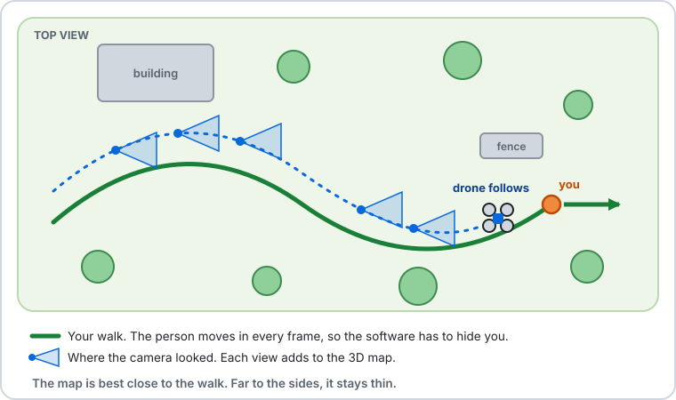
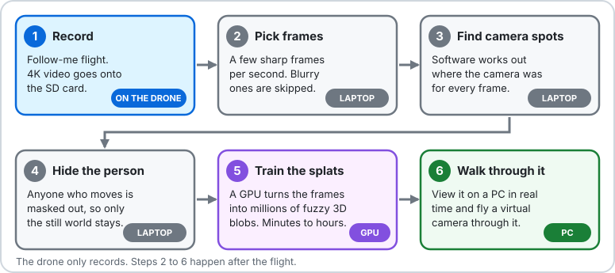

# Can a follow-me drone also build a 3D map of where you walked? YES.

**Drone A** = DJI Mini 4 Pro (a real drone, on sale today)

**Job B** = follow a person by itself, and turn its video into a 3D map you can look around in

## The big idea
The drone is not the problem. Follow-me and 4K video already exist in the drone.
The new part is **software after the flight**: it turns the video into a **Gaussian splat**.

A Gaussian splat is a 3D scene made of millions of tiny, soft, coloured blobs. It looks like a photo from any angle, and a normal PC can show it in real time.

1. Drone follows you by itself and records 4K video.
2. After landing, software picks the sharp frames and works out where the camera was for each one.
3. It hides you (you move, the world does not).
4. A GPU turns the frames into a splat. You look around it on screen.

## Sketch

## How it works

### The parts
| Part | In plain words |
|---|---|
| **Drone** | Under 249 g. 4K video at 60 frames per second. Up to about 34 min of flight in the best case *(real flights are shorter)*. Sensors on all sides help it avoid obstacles. |
| **Follow-me** | Built in (called ActiveTrack 360°). We do not program this. We only choose where we walk. |
| **Recording** | Video goes onto the SD card. The map is built **after** the flight, not during. |
| **Frame picker** | A small script takes a few sharp frames per second and skips blurry ones *(our guess: about 2 per second)*. |
| **Camera spots** | A tool called "structure from motion" (for example COLMAP) finds where the camera was and where it pointed in every frame. Gaussian splatting needs this. |
| **Person remover** | A splat assumes the world stands still. A walking person would turn into ghost smears. A person-finding model hides them in every frame. |
| **Splat trainer** | Runs on a GPU. Tens of minutes for a small scene, hours for a big one. |
| **Viewer** | Shows the splat in real time on a good PC. A vendor guide says 30 to 120 frames per second at 1080p *(approximate)*. |

### From video to 3D map

### What can go wrong, and what we do about it
| Problem | What we do |
|---|---|
| **You move in every frame.** A splat cannot handle things that move, so you become a smear. | Hide people in every frame (step 4). |
| **Follow-me flies in a line behind you.** The map is good along the walk and thin to the sides and behind. | Add a slow second pass after follow-me: side to side, or around the place we care about. |
| Motion blur when the drone or you move fast | Walk slowly. Pick only sharp frames. Use a fast shutter. |
| Plain areas such as grass, sky, water and blank walls | Software cannot find the camera spots there. Walk past buildings, trees and fences. |
| Light changes during the flight | Lock exposure and white balance. Fly in even light. |
| The map is not ready right after landing | Plan for "fly now, map later". Live splatting on the drone is not realistic. |
| Follow-me is a DJI feature we cannot change | It is fine for this idea. Our own code probably cannot drive this drone *(to check)*. |
| Flying rules and privacy: following and filming people | *Not checked yet.* Check local drone rules before any flight. |

### Why this is software work, not hardware
- **Nothing new to build in metal.** A drone with follow-me and a good camera is on sale today.
- **The pipeline** (frames, camera spots, person removal, training) has to run from one command, without hand fixing.
- **Flight planning** is the real craft: the walk and the second pass decide how good the map is.
- **Where it runs:** the drone only records. Everything else runs on a laptop and a GPU.

### Next step: one test
Walk a 3-minute route past buildings and trees in a quiet park with follow-me on. Build a splat with free tools (for example COLMAP and Nerfstudio) and look at where it breaks.

*Drone facts (under 249 g, 4K at 60 fps, ActiveTrack 360°, obstacle sensing, about 34 min best case): retailer listings of the DJI Mini 4 Pro. Splat facts (needs camera positions, assumes a still world, tens of minutes to hours to train, real-time viewing): research papers and a GPU vendor guide. Everything else is our own design. "Estimate", "our guess" or "to check" means not tested yet.*

*Is there a non-DJI option? Yes, but the non-DJI options are a clear step down in tracking quality from DJI’s ActiveTrack.*

- ***Potensic ATOM 2***: *the one most reviews pick as the best non-DJI sub-250g drone. Spotlight, Follow and Parallel AI Track modes, 4K HDR video and a 10 km range. The Fly More kit is listed at 249g, with 96 minutes of total flight time across three batteries.*
- ***HOVERAir X1 PRO / PROMAX***: *a self-flying camera built around following you. One listing shows 4K/60fps and a 42 km/h follow speed. A different type of product: a small pocket follower with no controller needed, not a conventional camera drone.*
- ***Holy Stone, Scrubuz, SKYROVER X1*** *and similar budget drones*: *they use GPS follow (one review says this also applies to Potensic's budget drones). It works in open terrain but is less dynamic and more crash-prone than vision tracking.*

**Follow-me modes:** Follow: it stays behind or beside you and moves when you move, Lead: it flies in front and films you coming toward it, Circle: it orbits you, Spotlight: it stays in place or lets you fly it, while the camera stays locked on the subject.

