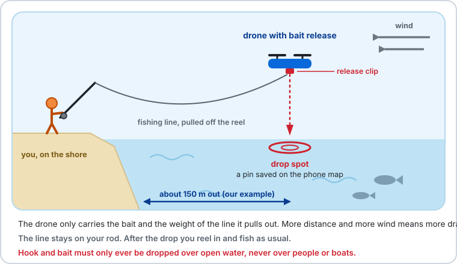
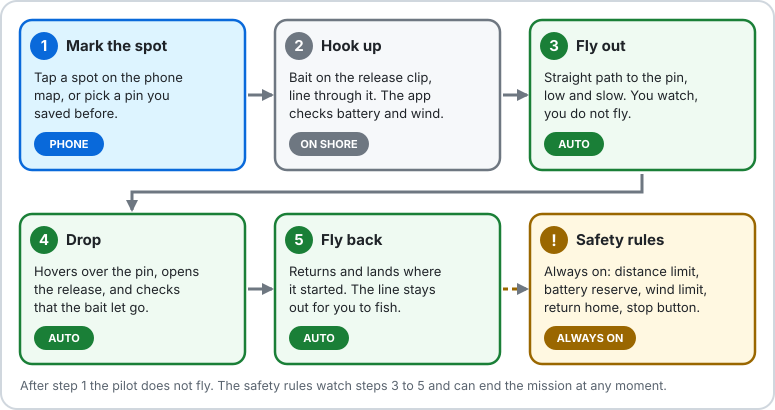

# Can a drone carry a fishing hook out and drop it at the right spot? YES.

**Drone A** = SwellPro Fisherman FD1 (a real fishing drone, sold in some regions)

**Job B** = fly out to a saved spot on the water by itself, drop the hook and bait there, and fly back

## The big idea
The drone is not the problem. Waterproof drones that carry bait and let go of it on command already exist.
Today a person flies it by eye and presses a release button. That is hard in wind and easy to get wrong.
The new part is **software**: tap a spot on the map, and the drone does the trip and the drop.

1. Tap the drop spot on a phone map, or pick a saved pin.
2. Put the bait on the release clip and run the line through it.
3. The drone flies out by itself, hovers over the pin and lets go.
4. It flies back and lands. The line stays out for you to fish.

## Sketch

## How it works

### The parts
| Part | In plain words |
|---|---|
| **Drone** | Waterproof (IP67). Carries about 2 kg of bait. Flies up to about 28 min (the maker's figure; shops say 30). Listed to handle wind up to 14.5 m/s. |
| **Release** | A remote-controlled clip under the drone. The fishing line runs through it. The clip lets go of the hook and bait over the drop spot. |
| **Line** | Stays on your rod and reel. The drone pulls it out, so the more distance and wind, the more drag. The app needs a distance limit. |
| **Autopilot** | GPS flies the path. Open autopilot software (for example ArduPilot) can already run "fly to a point, hover, move a servo, return" missions *(to check on the chosen drone)*. |
| **Phone app** | The new part. A map, saved pins, one button to start the mission, and a live status screen. |
| **Release check** | The app has to know the bait really let go. A camera view works, and a weight sensor on the clip would be better *(our idea)*. |
| **Safety layer** | Always on, as in the mission picture below. It can end the mission at any moment. |

### The mission

### The law: Germany and international waters
| Question | Germany | International waters |
|---|---|---|
| **Who makes the rules?** | Each Bundesland (its Fischereigesetz and Fischereiordnung), plus the owner or lessee of the water, usually a fishing club. | The **flag state** of the vessel has the main say (UNCLOS). Regional fisheries bodies (RFMOs) add rules for their sea areas. Closer to the coast, the coastal state's rules apply instead *(general knowledge)*. |
| **Dropping hook and bait by drone** | *No nationwide rule confirmed.* Drone flight rules are a separate hurdle: nature reserves and waterways are known problem areas. Fishing-method rules are probably strict, which is our guess, not a finding. | *No source found on drone bait drops.* It is unclear whether a drone counts as part of a "vessel" under UNCLOS (one 2018 law review says only tenuously). Ask the flag state's fisheries authority. |
| **Sensors to find fish** | Echo sounders are generally allowed, but the water's owner or club can ban them. Castable sonar for sounding without fishing is reported as allowed. *Nothing found on underwater cameras.* | *No source found on sonar.* Flag-state law covers which gear is allowed, and it is unknown whether any RFMO restricts fish-finding equipment. |
| **What we do** | Ask the Landesfischereiverband and the water's lessee in writing, for each water. | Ask the flag state's fisheries authority and check the RFMO for the sea area. |

*Sources are forum posts, news articles and law-review pieces, not law texts. This is not legal advice. Check the real rules before any flight.*

### What can go wrong, and what we do about it

**THE DRONE CANNOT SENSE FISH FROM THE AIR. IT MUST CARRY A SENSOR OUT AND DROP IT INTO THE WATER.**

### Competitors and price
| Drone | Price found (US dollars) | Note |
|---|---|---|
| **SwellPro Fisherman FD1** | **$1,147** in the maker's store (list $1,499 elsewhere) | Store says it is only sold in the US. |
| **SwellPro Fisherman FD1+** | **$899** on one review site (NZ$2,999 at a New Zealand shop) | Carries about 2.2 kg. |
| **SwellPro Fisherman Max** | **$1,599 to $2,299**, depending on the source | One review calls it the best fishing drone of 2026. |
| **SwellPro SplashDrone 4 / 4+** | **$1,499** for the 4, **$2,777** for the 4+ | Better camera, aimed at filming. |
| **Aeroo Pro** | **$999** | A reviewer says it does the pure fishing job for less. |
| **Gannet Pro, Rippton** | No reliable price found | A NZ shop puts Rippton in a $3,000 to $3,999 bracket. |

*Prices come from different shops and review sites on different dates, so they conflict. No Euro prices for Germany found yet, and no sales numbers for Germany from any source.*
