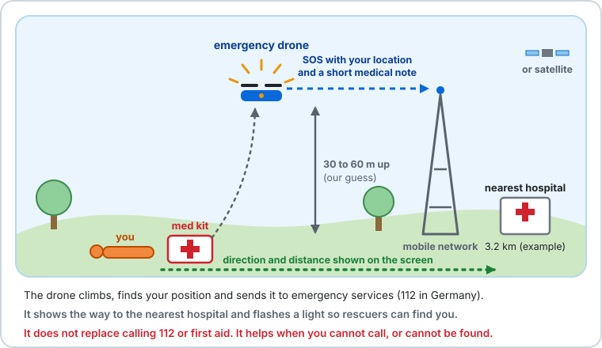
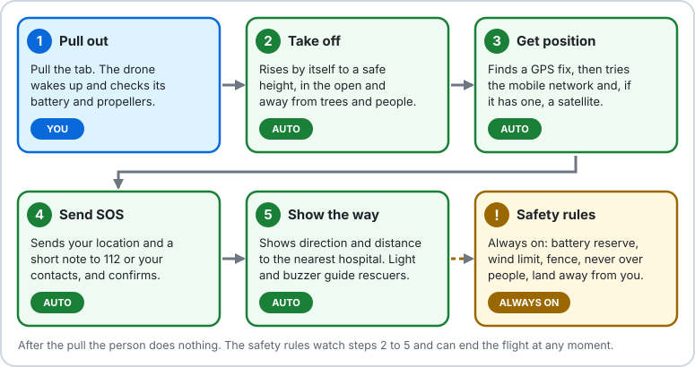

# Can a tiny drone in a med kit help you get help in an emergency? YES, with one big test.

**Drone A** = a palm-size folding drone that lives in a med kit *(no such product yet; pocket drones under 250 g exist)*

**Job B** = pull it out, and it rises by itself, sends your location to emergency services, shows the way to the nearest hospital, and lights up so rescuers can find you

## The big idea
The drone is not the hardest part. Small drones that launch from a hand already exist.
The new part is **a one-pull emergency routine** that works for a scared, hurt person who has no time to learn an app.
The drone is mostly a flying antenna, GPS and light. It does not replace a call to 112. It helps when you cannot call, or cannot be found.

1. Pull the tab. The drone wakes up.
2. It rises by itself to a safe height, away from trees and people.
3. It finds your position and sends it with a short medical note to 112 or your contacts.
4. It shows the direction and distance to the nearest hospital and flashes a light so rescuers find you.

## Sketch

## How it works

### The parts
| Part | In plain words |
|---|---|
| **Kit** | A foam box in the med kit with a pull tab, charging contacts and a self-test light. The kit keeps the battery topped up, because batteries lose charge while a kit sits for months. |
| **Drone** | Palm-size, folding, with propeller guards, under 250 g. It only needs a short flight: climb, hover and wait *(a few minutes, our guess)*. |
| **Position** | A GPS fix. Works in the open, not under dense trees or indoors. |
| **Link out** | Option A: Bluetooth to your phone, and the phone makes the call. Option B *(our idea)*: the drone has its own mobile modem or satellite chip, for when the phone is dead or has no signal. |
| **Hospital finder** | Offline map data of hospitals (for example open map data from OpenStreetMap) stored on the drone. It shows the nearest hospital, its distance and direction. It cannot fly you there. *To check: which hospitals have an emergency room, and how fresh the data is.* |
| **Signals** | A bright strobe and a loud buzzer, so rescuers can find you. |
| **Safety layer** | Always on, as in the mission picture below. It can end the flight at any moment. |

### The mission

### The law: Germany and the EU
| Question | What we know |
|---|---|
| **Emergency number** | 112 works across the EU *(general knowledge)*. Whether control centres accept an automatic message with a location and a medical note is *not checked*. |
| **Flying the drone** | EU drone rules (height limit, no flying over crowds, registration in some cases) apply to a private person. Whether there is an exception for emergencies is *not checked*. |
| **Radio parts** | A built-in mobile or satellite modem needs approval before sale *(to check)*. |
| **Medical data** | A short medical note stored on the drone is personal health data. Privacy rules apply *(to check)*. |

*Not legal advice. Check the real rules before any flight.*

### What can go wrong, and what we do about it
| Problem | What we do |
|---|---|
| **The height may not help.** There may still be no signal at 50 m. | Test it first (see the next step). Fallback: show the GPS position on the drone and flash the strobe, so a person can read it out or rescuers can spot it. |
| The battery is empty after months in the kit | Trickle-charge in the kit, a self-test light, and a warning when it is time to service. |
| A scared person presses the wrong thing | One pull, voice prompts, no menus. The SOS needs a short confirm and can be cancelled within 30 s *(our numbers)*. |
| False alarms waste emergency resources | The confirm step above, plus a clear "alarm sent" message and a cancel option. |
| Wind, rain, trees or darkness stop the flight | Wind limit and obstacle checks. If it cannot fly, it stays on the ground as a beacon with GPS and strobe. |
| The drone lands on or near the injured person | Land a few metres away, never over people. |
| It is too big for the kit | Pocket drones show it can be done. Size and weight decide which med kits it fits. |
| Flight rules and privacy | *Not checked yet.* See the law table above. |

### What already exists, and what we would build
| Already exists (we buy it) | We would build |
|---|---|
| Palm-size drones with GPS and automatic take-off | The **one-pull routine** from tab to sent SOS |
| Phone and satellite SOS gadgets | The **kit** with charging, self-test and the pull tab |
| Open hospital map data | The **hospital finder** (nearest hospital with an emergency room) |
| Cellular and satellite modules | The **SOS sender** with a confirm and cancel step |
| GPS flight and return home | The **safety rules**, kept separate so they always win |

### Competitors and price
| Product | Price found | Note |
|---|---|---|
| **Garmin inReach Mini 2** (satellite messenger with SOS) | **$340 to $400** for the device, plus a subscription from €14.99 per month | Not a drone. One seller says it is discontinued and replaced by the Mini 3 *(to check)*. |
| **Phone satellite SOS** (some iPhones and Android phones) | Included in the phone | *Not checked here:* German availability and cost. |
| **Everdrone AED drone** (Sweden) | Not sold to the public | Dispatched by the emergency service. In a study, the drone arrived before the ambulance in 37 of 55 cases, with a median lead of 3 min 14 s. |
| **Pocket drones** (for example HOVERAir X1 PRO / PROMAX) | No price found | They show that a palm-size self-flying drone exists. They have no emergency features. |

*Prices come from retail listings and a blog, so they may be out of date.*

### Next step: one test
Fly any small drone to 50 m at the edge of a forest or in a valley where the phone has poor signal. Check whether the phone gets a signal at that height, and for how long. This one test decides whether the "flying antenna" idea works.

*Facts: the Everdrone study (Karolinska Institutet, Lancet Digital Health) as reported in the news, and retail listings for the Garmin inReach Mini 2. Everything else is our own design. "Our idea", "our guess", "our numbers" or "to check" means not tested yet.*
