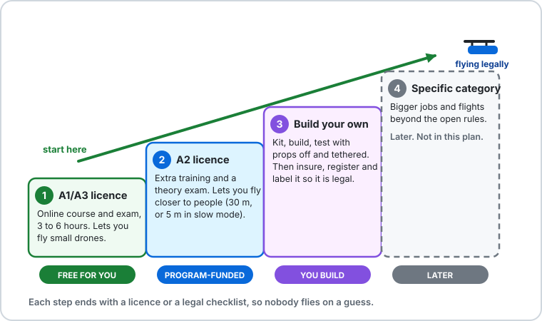
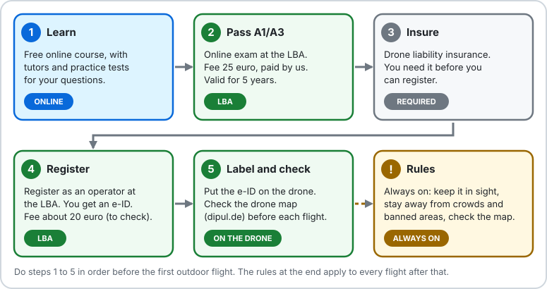

# Can we give people a free drone licence and teach them to build their own legal drones? YES.

**Program A** = a free A1/A3 course where we pay the exam fee, then A2 training, then a workshop to build your own drone

**Goal B** = people go from zero to flying a drone they built themselves, with every licence, registration and label in place

## The big idea
The hard part is not the drone. The licences already exist and the rules are public.
The new part is **a guided path**: we take away the cost and the confusion, and people finish with a drone that is fully legal.

1. **A1/A3 is free for the learner.** We teach the course and pay the exam fee.
2. **A2 comes next.** Extra training and a theory exam, so people can fly closer to others.
3. **Then they build their own drone** in a workshop, with a safety checklist.
4. **At every step there is a legal checklist**: insurance, registration, labelling, flight rules.

## Sketch

## How it works

### The parts
| Part | In plain words |
|---|---|
| **Course** | The official online course and exam for A1/A3 at the LBA (lba-openuav.de). About 3 to 6 hours. We add tutors and practice tests. |
| **Fee cover** | The LBA charges 25 euro for the exam. We pay it for every learner. |
| **A2 partner** | The LBA does not run the A2 exam. An approved outside exam body does. We pick a partner and book groups with them. *To check: the exact practical steps.* |
| **Practice field** | A safe, open place and a simulator, so people fly before they take the exam. |
| **Build workshop** | Kits, tools and a checklist for batteries, props-off tests, a tether and a kill switch. |
| **Legal desk** | Help with insurance, operator registration and putting the e-ID on the drone. |
| **Rules** | Always on, as in the checklist picture below. |

### The legal checklist

### The law: Germany and the EU
| Question | What we know |
|---|---|
| **A1/A3 licence** | Online course and exam at the LBA. 3 to 6 hours. Fee 25 euro (LBA procedure sheet). Valid 5 years. Lets you fly in the open category. One source says A3 means keeping 150 m from built-up areas *(to check)*. |
| **A2 licence** | Not offered by the LBA. You pass it through an approved outside exam body, then apply to the LBA. A multiple-choice exam, 75 % to pass (one provider). It allows flying closer to people: 30 m, or 5 m in low-speed mode *(general knowledge)*. |
| **Registration** | Needed for drones from 250 g, and for lighter drones with a camera unless they are certified toys. You get an e-ID that must be on the drone. You need liability insurance first. The fee is about 20 euro *(one deal site, to check)*. |
| **Your own drone** | A privately built drone can be flown in the open category *(one traveller guide; to check with the LBA and dipul)*. Registration and insurance still apply. |
| **Age** | Normally 16. The states can lower it to 12 *(one source)*. |
| **"Free"** | The exam is not free by default (25 euro), so we pay it. One deal site says A1/A3 can be free through another EU country. That is *unverified*, and you still register in your own country. |

*Sources are LBA procedure sheets, drone news and guide sites, not law texts. This is not legal advice. Check the LBA and dipul before teaching or flying.*

### What can go wrong, and what we do about it
| Problem | What we do |
|---|---|
| People fail the exam or drop out | Tutors, practice tests and small groups. We track the pass rate from day one. |
| Fees or exam steps change | Check the LBA every term. No fixed prices written into the course. |
| The A2 practical part is unclear | Ask an approved exam body before we promise anything *(to check)*. |
| Someone flies illegally after the course | A checklist for every flight, and the first flights are done in a group. |
| Insurance cost is unknown | Ask insurers about a group or student policy *(to check)*. |
| Home-built drones are unsafe (battery fires, fly-aways) | Workshop rules: props off for first tests, then tethered, with a kill switch and a time cap. These are the same rules we use on our own drone. |
| The rules for home-built drones are grey | Ask the LBA in writing before the workshop starts *(to check)*. |
| Who pays for it all? | Sponsors, schools and companies that need pilots. See the cost table. |
| A student crashes during a class | Event insurance for the program and a flight area away from people. |

### What already exists, and what we would build
| Already exists (we use it) | We would build |
|---|---|
| LBA online course and exam | **Free tutoring and practice tests**, and the fee paid for each learner |
| Approved A2 exam bodies and online schools | **One clear path** with a checkpoint at every step |
| Drone kits and open autopilots | **A build workshop** with a safety checklist |
| The LBA registration portal and the dipul map | **A legal desk** that fills in the paperwork with people |
| Drone liability insurance | **A group policy** for learners *(to check)* |

### Costs and competitors
| Step | Price found | Note |
|---|---|---|
| **A1/A3 exam (LBA)** | **25 euro** | From the LBA procedure sheet. We pay it. |
| **Operator registration** | about 20 euro | One deal site. Check on the LBA page. |
| **A2 course and exam, low end** | 79 to 99 euro | Online offers, often with a discount. |
| **A2 typical packages** | 200 to 350 euro | Course, online training and exam. |
| **A2 one-day on-site course** | 525 euro | One example, for a group of 8 to 20. |
| **Drone liability insurance** | No price found | *To check.* |
| **Our rough sum per learner** | about 245 euro plus insurance | 25 + 20 + about 200 *(our estimate)*. |

*Prices come from the LBA and from drone school and deal sites, and may be out of date.*

### Next step: one test
Run a pilot class of 10 people through the A1/A3 course with our tutors. Pay the fees, and measure the pass rate, the hours they needed and the questions they got stuck on.

*Facts: LBA procedure sheets, a German drone guide, school and deal sites, and an Austrian government overview. Everything else is our own design. "Our estimate", "to check" or "general knowledge" means not confirmed here.*

### Can it be digital?
| <mark>Part</mark> | <mark>Can it be digital?</mark> | <mark>Notes</mark> |
|---|---|---|
| <mark>A1/A3 course and exam</mark> | <mark>Fully</mark> | <mark>The LBA runs it online (lba-openuav.de). We add tutoring and practice tests around it.</mark> |
| <mark>A2 course and exam</mark> | <mark>Mostly</mark> | <mark>Several schools sell an online course with an online exam. One source mentions a theory exam on site, so the exact rules are unclear (to check).</mark> |
| <mark>Practice flying</mark> | <mark>Partly</mark> | <mark>A simulator and video lessons work online. Real flights still need an open field.</mark> |
| <mark>Build your own drone</mark> | <mark>Partly</mark> | <mark>Video lessons and a kit shipped to the learner work. A live video call helps for questions. Battery and first-test safety is still hands-on.</mark> |
| <mark>Legal desk (insurance, registration, labelling)</mark> | <mark>Fully</mark> | <mark>Step-by-step forms and a checklist.</mark> |

### Can we build the school ourselves?
Yes for the school, no for the official exam.

**What Claude Code can build from scratch**

* **Learning platform:** accounts, course pages, video lessons, progress tracking.
* **Practice tests:** a question bank with timed mock exams, scoring and a list of weak topics.
* **The legal checklist:** step-by-step forms for registration, insurance and labelling, as on the Idea 5 page.
* **Business side:** payments (Stripe or similar), the fee cover for each learner, an admin view for tutors, and e-mail reminders.
* **Build workshop part:** video lessons and a safety checklist.
* **Rough stack:** a web app (for example Next.js with Postgres), a hosted video service, and hosting in the EU for the privacy rules.

**Competitors have no simulator.** In the German and UK A2 online schools we looked at, none mentions a flight simulator in its course. *(Based on search summaries, not every course page, so check before we rely on it.)* We do not need to build one: we link to an existing simulator for the practice step.

