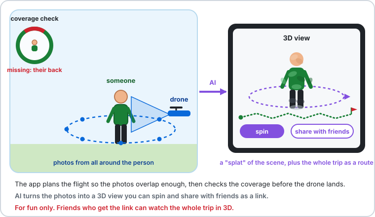
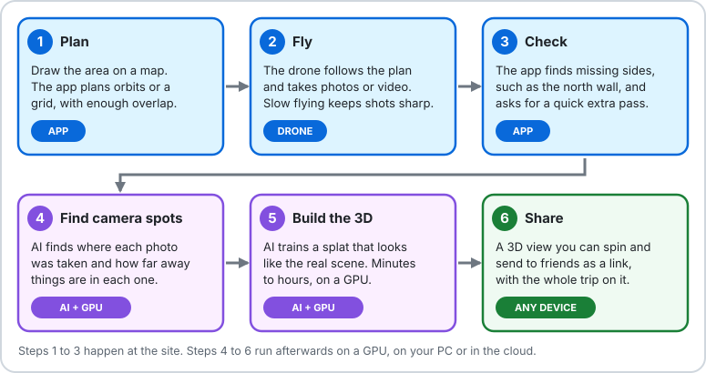

# Can software turn drone photos into an AI 3D view you can walk around? YES.

**Software A** = a drone 3D app that plans the flight, checks the photos, and builds the 3D view with AI

**Job B** = point a drone at a person, a place or a trip, fly it, and get a 3D view you can spin and share with friends

*For entertainment only. This is a fun way to relive and share a trip, not a tool for surveying or any official use.*

## The big idea
The drone is not the problem. Any drone with a good camera can take the photos.
The new part is **software that fixes the three things people get wrong**:

1. **Flying the right shots.** The app plans orbits or a grid, so the photos overlap enough.
2. **Knowing you got enough.** Before the drone lands, the app shows which sides are missing and asks for a quick extra pass.
3. **Building the 3D.** AI turns the photos into a 3D view you can spin on a phone or PC.
4. **Sharing the trip.** Friends who get the link can watch the **overall travel**: the whole route, drawn through the 3D scene.

## Sketch

## How it works

### The parts
| Part | In plain words |
|---|---|
| **Capture planner** | You draw the area on a map. The app makes the flight path (orbits for a building, a grid for a field) and sends it to the drone. *To check:* which drones accept a route from outside an app of their own maker. |
| **Drone** | Any drone with a steady camera. For example the one in Idea 2. It only takes photos or video. |
| **Coverage check** | After the flight, a quick low-quality pass tells you which sides have too few views, such as a wall nobody photographed *(our idea)*. |
| **AI reconstruction** | Finds where every photo was taken and how far away things are, then trains a **Gaussian splat** on a GPU. This takes tens of minutes to a few hours. Newer AI models can guess the camera spots straight from the photos *(to check)*. |
| **Trip route** | The GPS track of the flight (or of the person on the trip) is drawn as a line through the 3D scene, so friends see the overall travel *(our idea)*. |
| **Viewer** | A web page you open on any device. Spin, zoom, replay the route and send the link to friends. |
| **Privacy blur** | AI blurs faces and number plates before anything is shared *(our idea)*. |

### The pipeline

### The law: Germany and the EU
| Question | What we know |
|---|---|
| **Flying the drone** | Licence, registration, insurance and flight rules apply as on the education page (Idea 5). The app must not plan a route into banned areas. *To check:* an automatic route check against the dipul map. |
| **People in the photos** | Faces and number plates are personal data under EU privacy rules *(general knowledge)*. Blur them, and tell people when you shoot a place with people in it *(to check)*. |
| **Other people's buildings** | Ask the owner first. Whether the photos or the 3D model are restricted is *not checked*. |

*Not legal advice. Check the real rules before any flight or before selling a 3D model.*

### What can go wrong, and what we do about it
| Problem | What we do |
|---|---|
| **Missing sides or holes in the model** | The coverage check, and a quick extra pass before landing. |
| Glass, water, shiny surfaces, blank walls and sky confuse the software | Avoid them where you can. Put printed markers (like our ArUco tags) in the scene as anchors *(our idea)*. |
| People, cars and wind-blown trees move between photos | Hide moving things before training, as in Idea 2. |
| Light changes during the flight | Lock exposure and white balance. Fly in even light. |
| It takes too long | A fast low-quality preview first, then the full quality in the background. |
| Friends see more than you meant to share | A private link by default, and AI blur on faces and number plates before sharing *(our idea)*. |
| Very big areas break the computer | Split the area into tiles and build each one. |
| Cloud GPU cost | Price per model *not found yet*. Check it in the test below. |

### What already exists, and what we would build
| Already exists (we use it) | We would build |
|---|---|
| Drones with good cameras | A **capture planner** with overlap that adapts to the building |
| Open tools for camera spots and splats (for example COLMAP and Nerfstudio) | A **coverage check** before the drone lands |
| Mapping software (OpenDroneMap) | **One button** from photos to a shared link |
| Rented cloud GPUs | A **viewer** with the trip route, and **privacy blur** |

### Competitors and price
| Product | Price found | Note |
|---|---|---|
| **Agisoft Metashape** | **$179** Standard, **$3,499** Professional | One-time purchase. One guide. |
| **DJI Terra** | $1,680 to $2,780 per year | Sources conflict. A UK reseller lists £917.50 without VAT. Made for DJI drones. |
| **Pix4D** | No public price | One comparison estimates about 12,000 over three years for Pix4Dmapper *(estimate)*. |
| **RealityScan** (was RealityCapture) | Free | For individuals and small businesses, per one comparison. Check the terms. |
| **OpenDroneMap / WebODM** | Free | Open source. You run it yourself. |
| **KIRI Engine** | $18 per month | Turns splats into meshes. |
| **Luma AI** | $300 per month | Business tier. The only price found. |
| **Scaniverse** | Free | Runs on the phone. Exports splats. |
| **Terrasolid TerraSplat** | €350 per year | Splats for drone work. |
| **Polycam, Postshot** | No reliable price found | Check on their sites. |

*Prices come from review and comparison sites, not vendor pages, and may be out of date. Metashape, DJI Terra and Pix4D are professional mapping tools. For a fun app, the closest ones are KIRI Engine, Luma AI, Scaniverse, Polycam and Postshot.*

### The tech: fun mode, a 3D you that AI can change
We do not want a survey tool. We want people to **see a 3D version of themselves** and then **change it with generative AI**: a new outfit, a cartoon look, a fantasy background, a different season. Then they share it with friends.

| Step | What happens | What exists today |
|---|---|---|
| **1. Capture yourself** | The drone orbits you once. A short video of a person is enough. | Research shows 3D Gaussian avatars from a single phone video, in under 40 minutes (GSAC paper), and from a few phone photos (Capture, Canonicalize, Splat). *Both are papers. We did not check for released apps or code.* |
| **2. Cut out the person** | AI separates you from the background, so you can be edited on your own. | Standard segmentation tools *(general knowledge)*. |
| **3. Change it with a sentence** | You type "make me a knight" or "make it look like a cartoon" and the AI edits the 3D. | GaussianEditor (CVPR 2024) edits only a chosen region from a text instruction, in about 20 minutes on one GPU. Instruct-GS2GS changes the whole scene and runs in Nerfstudio. |
| **4. Fill in what the drone missed** | The back of your head or your legs, if the coverage check found gaps. | One 2026 paper (AHOY) uses video AI to fill hidden body parts. *Research only.* |
| **5. Place yourself in a scene** | Drop your 3D self into the 3D place from the trip. | The AHOY paper places avatars into phone-captured splat scenes. *Research only.* |
| **6. Share it** | A link where friends spin you around and watch the trip route. | The viewer from the parts table above. |

**What we would build:** the **fun layer on top**: one button from drone orbit to a person, a list of ready-made looks, and the share link. The hard AI parts already exist as research code. Our work is to join them, make them fast and make them safe to use.

| Problem | What we do |
|---|---|
| Instruct-GS2GS has trouble adding entirely new shapes (a hat, a sword) | Start with looks that change colour and texture. For new shapes, test GaussianEditor-style local edits *(to check)*. |
| A face is personal data, and the AI uploads it to a GPU | Ask for consent before capture, delete the 3D after the trip unless you keep it, and let people delete it any time *(general knowledge; to check under EU privacy rules)*. |
| Someone edits a friend into something unfair | By default you can only edit a 3D of yourself, and every shared edit is labelled "AI-edited". |
| Edits look strange from some angles | Keep the looks simple at first, and check every look from all sides before it goes in the list. |
| Cost of the GPU per person | Price per run *not found yet*. Measure it in the test below. |

*Sources: [GaussianEditor](https://arxiv.org/html/2311.16037v2), [Instruct-GS2GS](https://docs.nerf.studio/nerfology/methods/igs2gs.html), [GSAC](https://arxiv.org/html/2504.12999v1), [Capture, Canonicalize, Splat](https://arxiv.org/html/2510.14081v1), [AHOY](https://arxiv.org/html/2603.17975). All are research papers or research code. Whether any of them is good enough for a phone-quality fun app is not tested.*

### Next step: one test
Fly a 5-minute orbit around a small building or a tree with any camera drone. Build a splat with a free splat tool, share the link with two friends, and ask what they liked and what looked wrong. Note how long it took and which sides the coverage check would have flagged.

*Facts: comparison and review sites for the competitor prices, and the research notes from Idea 2 for how splats work. Everything else is our own design. "Our idea", "our guess", "estimate" or "to check" means not tested yet.*
